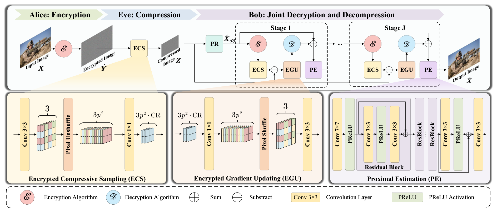

<div align="center">

# DeepELIC

**Deep Encrypted Lossy Image Compression Network via Compressive Sensing Unfolding**

[](https://doi.org/10.1016/j.patcog.2026.114311)
[](https://doi.org/10.1016/j.patcog.2026.114311)
[](#installation)
[](#installation)
[](LICENSE)

**Fangyuan Gao<sup>1</sup> · Yufan Deng<sup>1</sup> · Xin Deng<sup>2,3</sup> · Zhenyu Guan<sup>1</sup> · Mai Xu<sup>2</sup>**

<sub><sup>1</sup> School of Cyber Science and Technology, Beihang University, Beijing, China</sub><br>
<sub><sup>2</sup> School of Electronic and Information Engineering, Beihang University, Beijing, China</sub><br>
<sub><sup>3</sup> State Key Laboratory of Virtual Reality Technology and Systems, Beihang University, Beijing, China</sub>

Published in **Pattern Recognition**, Vol. 180 (2026), Article 114311.

</div>

<p align="center">
  
</p>

<p align="center"><em>
The overall framework of DeepELIC. The sender (Alice) encrypts the image with a global random permutation (GRP) followed by a negative-positive transform (NPT). A semi-honest cloud (Eve) compresses the encrypted image through the Encrypted Compressive Sampling (ECS) module. The receiver (Bob) reconstructs the original image with a cascade of Joint Decryption and Decompression (JDD) stages, each built from ECS, Encrypted Gradient Updating (EGU) and Proximal Estimation (PE) modules.
</em></p>

## Overview

Encrypted image compression (EIC) aims to compress an image while it is still encrypted. DeepELIC is, to the best of our knowledge, the first deep unfolding network for this task: starting from a 2D compressive sensing based EIC formulation (CS-EIC), its iterative proximal-gradient-descent solver is unfolded into a differentiable layered architecture in which every module keeps an explicit physical meaning.

The implementation is self-contained and pure PyTorch: it only depends on `torch`, `torchvision`, `numpy`, `Pillow` and `torchmetrics`, with no compiled extensions, no external checkouts and no pretrained denoisers.

## Highlights

- **Interpretable by construction** — the network maintains a strict mathematical correspondence with the CS-EIC algorithm, so each module can be traced back to one step of the optimizer.
- **Integrated reconstruction** — decryption and decompression are performed jointly inside every JDD stage, instead of decrypting first and decompressing afterwards.
- **Efficient encrypted-domain compression** — 2D block compressive sensing is used for sampling, which is cheaper than 1D-CS and non-uniform downsampling based schemes.
- **Released weights** — nine pretrained checkpoints covering the main ratios (1/4, 1/9, 1/16) and six additional ratios from 0.20 to 0.70.

## Contents

- [Installation](#installation)
- [Datasets](#datasets)
- [Training](#training)
- [Evaluation](#evaluation)
- [Pretrained Checkpoints](#pretrained-checkpoints)
- [Repository Structure](#repository-structure)
- [Citation](#citation)
- [License](#license)

## Installation

The code is tested with Python 3.10–3.12, PyTorch 2.2.2 and torchvision 0.17.2. Run the following commands inside the repository root:

```bash
git clone https://github.com/Xiao-Fang-12138/DeepEIC_encrypted_image_compression.git
cd DeepEIC_encrypted_image_compression

python -m venv .venv
source .venv/bin/activate          # Windows: .venv\Scripts\activate
python -m pip install -r requirements.txt
```

Everything runs directly from the repository root, so no build step or package installation is needed. Use `--device cpu`, `--device cuda`, or the default `--device auto`, which selects CUDA when available.

**Mode switching.** Training always uses continuous measurements without quantization, while evaluation always applies per-image 8-bit min/max quantization followed by dequantization. The forward pass selects the behavior from `model.train()` / `model.eval()`, so keep the model in the correct mode.

## Datasets

Dataset images are not redistributed with this repository. Create the directories below inside the repository root and place legally obtained benchmark images there (PNG, JPEG, BMP, TIFF or WebP; PNG avoids extra lossy coding):

```text
data/train/DIV2K/       # DIV2K training HR images
data/test/DIV2K/        # DIV2K validation HR images
data/test/BSDS100/
data/test/Urban100/     # HR images only
data/test/Manga109/
```

Subdirectories are searched recursively and images are sorted by relative filename. Images are loaded as RGB in [0, 1]. All CLI paths are relative to the repository root; absolute paths, parent-directory escapes and symlinks that leave the repository are rejected. Training images must be at least the configured crop size, and evaluation images must be at least 11 pixels wide/tall for the SSIM window.

## Training

The main tasks are 2×, 3× and 4× spatial subsampling, corresponding to nominal measurement ratios of **1/4, 1/9 and 1/16** (not 1/2, 1/3 or 1/4). Each task is trained from scratch with:

```bash
bash training/train_x2.sh --device cuda
bash training/train_x3.sh --device cuda
bash training/train_x4.sh --device cuda
```

The default data paths are `data/train/DIV2K` and `data/test/DIV2K`. Training outputs go to `training/runs/<task>/` and contain the resolved configuration, a JSON-lines loss log, `latest.pth`, and `best.pth` whenever quantized validation improves. Checkpoints are written atomically.

The configuration files expose the training recipe: random 256×256 crops with horizontal and vertical flips, batch size 16, Adam with betas (0.9, 0.999) and weight decay 1e-8, initial learning rate 1e-4, decayed by a factor of 0.8 every 2000 steps, and a target of 5,000,000 steps. The loss keeps the research implementation's `255**2 * MSE` scaling.

Initialize from released weights (weights only), or resume a run produced by this trainer (optimizer, scheduler, step and RNG state):

```bash
bash training/train_x2.sh --init checkpoints/deepelic_x2.pth --learning-rate 0.00001
bash training/train_x2.sh --resume training/runs/x2/latest.pth
```

Released checkpoints contain weights and model metadata but no historical optimizer state, so use `--init` for them. `--resume` rebuilds the data iterator and does not guarantee the exact pre-interruption batch order. `--max-steps` is the total target step, including already completed steps.

## Evaluation

Evaluate the main tasks with mandatory 8-bit quantization:

```bash
bash testing/evaluate_x2.sh --data data/test/DIV2K --output results/x2_DIV2K --save-images
bash testing/evaluate_x3.sh --data data/test/DIV2K --output results/x3_DIV2K --save-images
bash testing/evaluate_x4.sh --data data/test/DIV2K --output results/x4_DIV2K --save-images
```

Change `--data` to evaluate BSDS100, Urban100 or Manga109. Each output directory is created automatically and contains per-image and mean metrics in `metrics.json`; `--save-images` additionally stores the reconstructions. By default complete images are evaluated: symmetric reflection padding to a multiple of 64 is applied, and the padding is removed before scoring (replicate padding is used for images too small for reflection). `--crop 512` is an optional center-crop diagnostic and does **not** correspond to the full-resolution reference protocol.

Metrics follow the reference protocol: PSNR is computed on clamped RGB images converted to uint8 by truncation, and SSIM is computed on the floating-point RGB reconstruction before clamping with TorchMetrics (`data_range=1.0`). Metrics are averaged per image, with no luminance conversion and no border shaving.

Use the same entry points for the other ratios, e.g.:

```bash
python -m testing.evaluate --config configs/cr_40.json --data data/test/DIV2K --output results/cr_40_DIV2K
python -m training.train   --config configs/cr_40.json --device cuda
```

## Pretrained Checkpoints

Nine checkpoints are released in `checkpoints/`. A checkpoint is loaded strictly (`strict=True`) and its stored architecture metadata must match the selected configuration; changing `model.subrate` without switching to the corresponding checkpoint is invalid.

| Task | Nominal measurement ratio | Enc. channels | Configuration | Weights |
|---|---|---:|---|---|
| 2× | 1/4 | 192 | `configs/x2.json` | `checkpoints/deepelic_x2.pth` |
| 3× | 1/9 | 85 | `configs/x3.json` | `checkpoints/deepelic_x3.pth` |
| 4× | 1/16 | 48 | `configs/x4.json` | `checkpoints/deepelic_x4.pth` |
| CR 0.20 | 0.20 | 154 | `configs/cr_20.json` | `checkpoints/deepelic_cr_20.pth` |
| CR 0.30 | 0.30 | 230 | `configs/cr_30.json` | `checkpoints/deepelic_cr_30.pth` |
| CR 0.40 | 0.40 | 307 | `configs/cr_40.json` | `checkpoints/deepelic_cr_40.pth` |
| CR 0.50 | 0.50 | 384 | `configs/cr_50.json` | `checkpoints/deepelic_cr_50.pth` |
| CR 0.60 | 0.60 | 461 | `configs/cr_60.json` | `checkpoints/deepelic_cr_60.pth` |
| CR 0.70 | 0.70 | 538 | `configs/cr_70.json` | `checkpoints/deepelic_cr_70.pth` |

All models use block size 16, five JDD stages and three residual blocks per stage. The number of measurement channels is `round(3 * block_size**2 * subrate)`, so the actual ratio of the 3× setting is 85/768.

## Repository Structure

```text
DeepELIC/
├── assets/           # Architecture figure
├── checkpoints/      # Nine released pretrained weights (*.pth)
├── configs/          # Model and training configuration (9 JSON files)
├── network/          # DeepELIC model, GRP/NPT encryption, dataset and runtime utilities
├── testing/          # Quantized evaluation entry point and task launchers
├── training/         # Training entry point and task launchers
├── requirements.txt
├── README.md
├── CITATION.cff
└── LICENSE
```

## Citation

If you find this code or the pretrained weights useful, please cite our paper:

```bibtex
@article{gao2026deepelic,
  title   = {DeepELIC: Deep encrypted lossy image compression network via compressive sensing unfolding},
  author  = {Gao, Fangyuan and Deng, Yufan and Deng, Xin and Guan, Zhenyu and Xu, Mai},
  journal = {Pattern Recognition},
  volume  = {180},
  pages   = {114311},
  year    = {2026},
  issn    = {0031-3203},
  doi     = {10.1016/j.patcog.2026.114311}
}
```

Plain-text form:

> F. Gao, Y. Deng, X. Deng, Z. Guan, M. Xu, DeepELIC: Deep encrypted lossy image compression network via compressive sensing unfolding, Pattern Recognition 180 (2026) 114311. https://doi.org/10.1016/j.patcog.2026.114311

Citation metadata is also available in [`CITATION.cff`](CITATION.cff).

## License

DeepELIC is released under the [MIT License](LICENSE). The code, configurations and pretrained weights are provided for research use; if you use them in your work, please cite the paper above.
